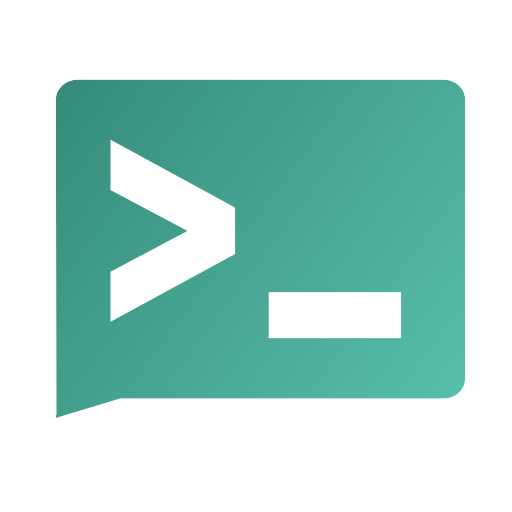

<p align="center">
  <picture>
    <source media="(prefers-color-scheme: dark)" srcset="assets/icon-dark.svg">
    
  </picture>
</p>

<h1 align="center">aac-ntfy</h1>

<p align="center">Self-hosted deployment definition for ntfy, a simple HTTP-based push notification service.</p>

<p align="center">
  <a href="https://github.com/binwiederhier/ntfy"></a>
  
  <a href="https://github.com/binwiederhier/ntfy/blob/main/LICENSE"></a>
</p>

## About

ntfy lets you send push notifications to your phone or desktop with a simple HTTP `PUT` or
`POST` request. Topics are addressed by name, so any script, service or automation that can
send an HTTP request can notify subscribed clients. Clients are available as mobile apps,
in the browser and via the command line.

Key features (as provided by upstream):

- Publish messages with plain HTTP requests, no account required for simple use
- Subscribe through the web app, mobile apps, desktop clients or the command line
- Message cache so recent notifications can be fetched after a client reconnects
- Attachments, actions, priorities and tags on messages
- Self-hostable, with optional authentication and access control

## Upstream

- Project: <https://github.com/binwiederhier/ntfy>
- Website: <https://ntfy.sh>
- Documentation: <https://docs.ntfy.sh>
- Container image: `binwiederhier/ntfy:latest` (Docker Hub)
- License: Apache-2.0 or GPL-2.0 (upstream project, dual-licensed)

## Quick start (Docker Compose)

The Compose file is rendered from `service.yml` by the App-as-Code template engine. For a
manual run, start the stack from the rendered deployment files:

```bash
docker compose up -d
```

The container runs the `serve` command with `init` enabled and restarts with the policy
`unless-stopped`.

## Configuration

Environment variables (defaults from `service.yml`):

| Variable | Default | Description |
|---|---|---|
| `TZ` | `Europe/Berlin` | Time zone of the container |

No secrets are required by this definition. Further ntfy server options can be added to the
service definition if needed; see the upstream documentation.

Ports:

| Port | Protocol | Purpose |
|---|---|---|
| `80` | TCP | HTTP web interface and API (`web`); published externally as `25125` |

Volumes:

| Mount | Description |
|---|---|
| `cache` -> `/var/cache/ntfy` | Persistent message cache |
| `config` -> `/etc/ntfy` | Configuration directory |

The container exposes a health check against `/v1/health`, run every 60 seconds.

## Deploy with App-as-Code

1. Edit `service.yml`. It is the single source of truth for image, ports, environment,
   volumes and per-stage overrides. Do not edit the rendered output.
2. Pushing to `main` (or a configured stage branch) runs the service pipeline, which renders
   the manifests with `aac-template-engine` and triggers the deployment.
3. Releases of this definition are published under <https://github.com/app-as-code/aac-ntfy>.

## Credits and license

ntfy is developed by the ntfy project and its contributors and is dual-licensed under the
Apache License 2.0 and the GNU GPL v2. This repository only contains the deployment
definition for it and is not a fork of the application. The logo is provided by the
selfh.st icon collection; see [`assets/ICON_SOURCE.md`](assets/ICON_SOURCE.md) for icon
sources and licenses.
